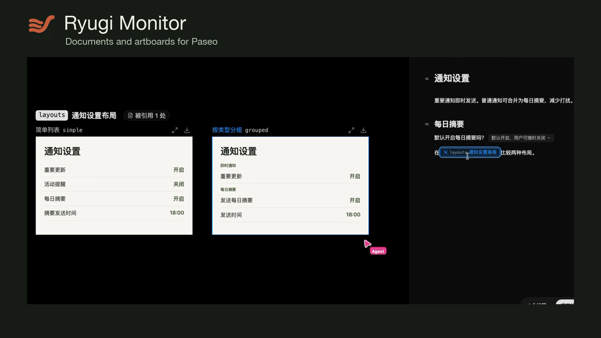

# Ryugi Monitor

**从 Paseo 原会话打开 Artideck（原 Ryugi）工件，让批注、方案选择和答复直接回到 Agent。**

在电脑上看画板、换一台设备继续审阅，或直接在 Artideck 里回答 Agent 的问题。反馈提交后，原会话会收到通知，Agent 可以接着处理。

[快速开始](#快速开始) · [跨设备访问](#跨设备访问) · [本地开发](#本地开发) · [版本发布](https://github.com/zwmmm/ryugi-paseo-plugin/releases)



[观看操作演示（MP4）](assets/ryugi-demo.mp4)

## 能做什么

| 能力 | 在 Paseo 里怎么用 |
| --- | --- |
| **从会话直达工件** | 输入框上方显示当前会话的文档、画板、HTML、幻灯片、白板、验证报告、数据报告和分镜入口。每种工件显示一个入口，可选用 Paseo 内置浏览器或系统默认浏览器打开。 |
| **换设备继续审阅** | 同机点击直连 Artideck。异机点击原入口时，通过密码保护的 TryCloudflare 临时链接打开。同一宿主、同一端口的工件共用一个公网域名。 |
| **反馈回到原会话** | 评论、方案选择、答复和撤回会通知关联的 Agent。时间线默认折叠成摘要，点开可查看原文。 |
| **会话自带 Artideck 工作流** | 插件提供隔离的 Artideck CLI 和完整工作流技能，覆盖需求、设计、实现、调试和验证。项目组件与规范仍从实际源码工作区读取。 |

## 快速开始

在**运行 Agent 会话的 Paseo 宿主**安装插件。宿主需要 Paseo 0.17.3 或更高版本、Node.js 20.12 或更高版本、npm 和 Git。安装时会联网准备隔离的 Artideck 运行时。

```bash
paseo plugin install npm:ryugi-paseo-plugin
```

也可以直接从 GitHub 安装。

```bash
paseo plugin install git:zwmmm/ryugi-paseo-plugin
```

1. **创建工件**。打开 Agent 会话，例如发送「设计一个通知设置页面，给出两种布局方案」。
2. **打开工件**。Agent 交付后，点击输入框上方的「文档」或「画板」。可以在插件的「工件浏览器」设置中选择浏览器。
3. **提交反馈**。在 Artideck 留言、选择一个方案或回答问题。回到 Paseo 可在原会话查看通知，Agent 会收到完整反馈。

## 跨设备访问

在会话宿主打开 **Paseo → 设置 → 插件 → Ryugi Monitor** 的设置，在「远程访问」区块输入访问密码。密码会自动保存。宿主和插件保持在线时，即可跨设备访问。

| 操作 | 结果 |
| --- | --- |
| **在其他设备点击原会话入口** | 按需开启隧道，或复用该端口已有的隧道。首次在该浏览器打开时输入访问密码。 |
| **提前开启隧道** | 在设置页点击开启，无需先打开会话。之后点击同端口的其他工件入口会复用这个域名。 |
| **关闭隧道** | 在设置页主动关闭，已有链接失效，访问密码保留。下次异机点击工件入口时会生成新链接。 |
| **更改或清空密码** | 更改密码会结束现有隧道。清空密码会关闭远程访问。 |

远程请求经 Cloudflare 转发。访问密码适用于整个 Artideck 主端口，包括主页、其他会话的工件、内嵌资源、HTTP API（含管理接口）和 WebSocket。

## 本地开发

在插件源码目录执行以下命令。

```bash
npm install
npm run setup:runtime
npm run typecheck
npm test
```

<details>
<summary>运行时目录与依赖</summary>

- 默认运行时为 `~/.paseo/artideck-runtime`，可在启动插件进程前通过 `PASEO_ARTIDECK_RUNTIME_DIR`（或兼容变量 `PASEO_RYUGI_RUNTIME_DIR`）调整。运行时内的 CLI 位于 `node_modules/artideck/dist/cli.cjs`，技能位于 `workflow/skills`，服务状态位于 `state/server`。
- 工作区工件保存在 `projects/<工作区绝对路径的 SHA256 前 16 位>/.artideck/artifacts`（兼容旧 `.ryugi/artifacts`）。插件使用独立的 Unix socket。原有全局 Artideck / Ryugi 工件不会自动迁移。
- Artideck 主服务候选端口为 27419–27421，画板服务候选端口为 27429–27431。隧道使用 Artideck 实际监听的主端口，代理端口由系统分配。
- 安装流程会动态获取 npm 最新稳定版 `artideck` 与对应版本标签的工作流（不固定版本号），并为 macOS / Linux x64、arm64 及 Windows x64 下载、校验并缓存官方 cloudflared。打开工件时复用已安装的程序。

</details>

<details>
<summary>会话绑定与反馈</summary>

- 插件在交互会话打开时注入 `ryugi` 工具和技能路径。默认按上游 `using-adeck`（兼容 `using-ryugi`）路由工作流，普通问答和只读检查无需进入工作流。
- 工具启动工件或 Agent 交付本地地址后，插件会绑定该会话。同一工件关联多个会话时，各会话都可收到反馈。反馈通过 socket 推送，传输确认仅表示反馈已送达会话。
- 文件事件刷新工件入口，60 秒轮询作为兜底。关闭 Paseo 客户端后，宿主上的反馈监听仍可运行。插件重载后，会在会话恢复、完成一轮或界面同步时重建绑定。
- 通知摘要和工件入口随 Paseo 切换为中文或英文，其他语言使用英文。评论正文和原始通知保留原文。`slides` 工件的主文件使用 HTML。
- 插件通过专用运行时启动 Artideck，Agent 会话无需另装全局 hook 或 Paseo Hub Triggers。插件重载后，空闲会话会在下次发送消息前重新打开并取得工具与指令。

</details>

---

Ryugi Monitor 是面向 Paseo 的独立集成。Artideck 工件工具、工作流和标识来自 [Innei/artideck](https://github.com/Innei/artideck)。
